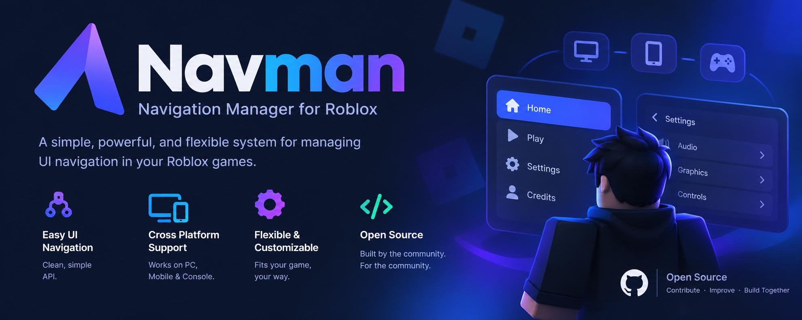

# 
Navman - UI Navigation made Easy.

  > **Context-aware UI navigation for Roblox. Free, open-source, and built for cross-platform support.**

 

***Navman*** is an open-source library that makes Roblox UI work everywhere **instantly**. It drops the headache of cross-platform setup, giving you a clean, simple API to get *controllers*, *keyboards*, and *mobile menus* running in minutes.

> [!IMPORTANT]
> This API is still in **early-development**, bugs may occur. If you run into any, please go ahead and **report it**.

## Why Navman?

If you've ever tried to add controller support to your game, you know how **frustrating** Roblox's default UI Navigation can be. ***Navman*** aims to make UI Navigation *easier*, and *universal* on all platforms. Giving developers **full control** on the elements the users get to interact with. Allowing for a more *seamless* playing experience.
### 🚀 Key Features

* **Cross-Platform**: Built from the ground up to unify controllers, keyboards, and touchscreens into a single, flawless navigation experience.
* **UI-Contexts**: UI Contexta are a digital blueprint for your menus, locking player inputs to the active screen and dictating exactly how buttons link together.
* **Event Binding**: Create new UI Events that can be fired through script, or bound by a key/button.
* **Full UI-Control**: All buttons can now be fired through script, bound to a key/button, or bound to another buttons.

## Documentation
> **Full documentation** can be found at the [Navman Docs](https://github.com/itseasyy/Navman). You can find documentation for my other projects [here](https://github.com/itseasyy).
